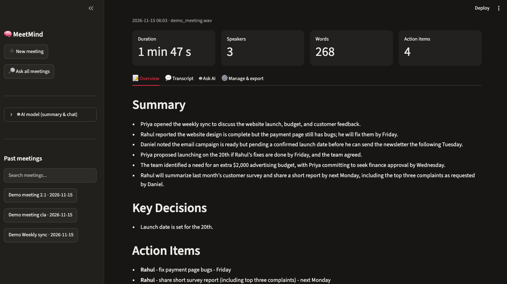
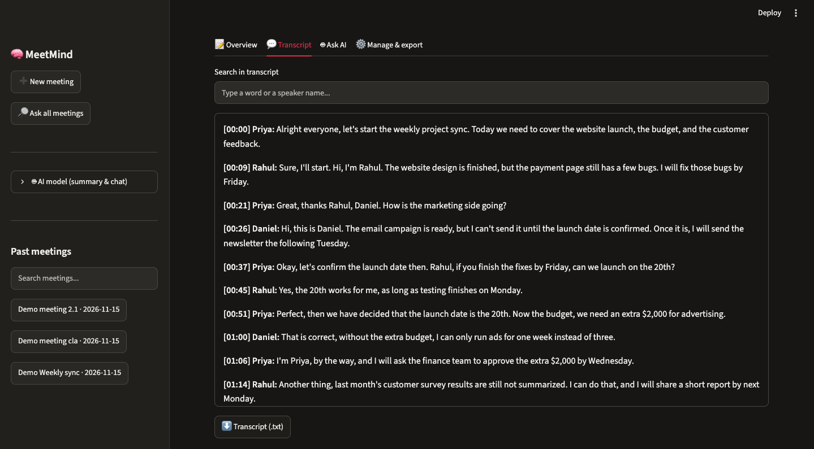
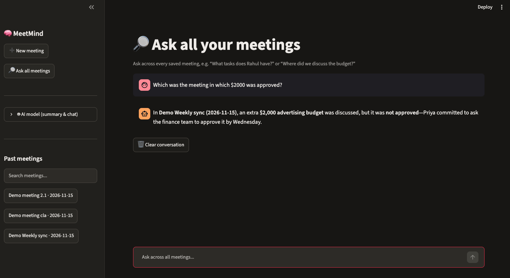

# 🧠 MeetMind: Local AI Meeting Intelligence







Turn meeting recordings into **speaker-labeled transcripts, summaries and action items**, using free tools and a model-agnostic LLM layer. Audio is transcribed on your own machine.

## Features

- **Transcription** with faster-whisper (local, CPU), with vocabulary hints for names and jargon
- **Speaker detection** with pyannote 3.1, assigned **word by word** so short interruptions are caught
- **Structured output:** summary, key decisions, open questions, and an action-items table (CSV / Word export)
- **Ask AI** about one meeting, or **across all saved meetings**
- **Saved meetings** in SQLite, with speaker renaming and transcript search
- **Upload or record** from the browser microphone
- **Switchable LLM:** OpenRouter, Groq, local Ollama, or any OpenAI-compatible API, with a *Test connection* button

## How it works

```
recording → ffmpeg (16 kHz mono, cleanup)
          → faster-whisper  → words + timestamps
          → pyannote        → who spoke when
          → merge           → "[00:15] SPEAKER_01: ..." transcript
          → LLM (your choice) → summary, decisions, action items, Q&A
          → SQLite + Streamlit UI
```

## Quick start

Requires **Python 3.11** (3.13 is not supported by the dependencies), **ffmpeg**, and a free Hugging Face account.

```bash
git clone https://github.com/anasilahi10/MeetMind.git
cd MeetMind
conda create -n meetmind python=3.11 -y && conda activate meetmind
conda install -c conda-forge ffmpeg -y
pip install -r requirements.txt        # or: uv pip install -r requirements.txt
```

1. On Hugging Face, accept the terms for `pyannote/speaker-diarization-3.1` and `pyannote/segmentation-3.0`, then create a **Read** token.
2. Copy `.env.example` to `.env` and fill in your keys (OpenRouter key and the Hugging Face token).
3. Run `streamlit run app.py`.

No recording handy? On macOS, `python make_demo.py` generates a 3-speaker demo meeting (`demo_meeting.wav`) with built-in voices.

## Choosing a model

Open **AI model** in the sidebar: pick a provider and model (or enter a custom model ID), paste an API key if you do not use `.env`, and click **Test connection**. Free models work; stronger models give better summaries.

## Tests

```bash
pip install pytest
python -m pytest -q
```

## Design decisions

- **Word-level speaker assignment:** each word gets the speaker active at its timestamp, and one- or two-word flips are smoothed. This catches interruptions that sentence-level assignment hides.
- **Map-reduce summarization:** long transcripts are chunked, summarized per chunk, then combined, so free models with small limits still work.
- **Honest output:** low-confidence passages are marked `[unclear]`, and prompts tell the model not to invent facts or treat suggestions as tasks.
- **Privacy:** audio never leaves your machine. Only transcript text is sent to the LLM provider you choose (nothing leaves if you use local Ollama).
- **Provider abstraction:** one OpenAI-compatible client works with OpenRouter, Groq, Ollama and custom endpoints.

## Results and limitations

Tested informally, on small samples:

- A synthetic 3-speaker demo meeting: all scripted action items (owner, task, deadline) were extracted correctly.
- A real 3-minute product-team meeting clip recorded through speakers: transcript mostly accurate with the `small` model plus vocabulary hints, and a short interruption was correctly attributed to a second speaker.

Known limitations:

- **Speed:** CPU-only processing is slow. A short clip can take several minutes.
- **Accuracy:** no formal WER/DER evaluation yet. Overlapping speech, noise and similar voices reduce speaker accuracy, and words at the edge of speech can be clipped.
- **Free LLMs** can make small mistakes (for example, assigning a task to the wrong person), so check the transcript.
- Speaker labels are generic (`SPEAKER_00`) until you rename them.
- Dependency pins (`numpy<2`, `pyarrow<20`, `huggingface_hub<0.28`) exist for compatibility with pyannote 3.3 and PyTorch on macOS.

## Roadmap

- Formal WER/DER evaluation on the AMI meeting corpus
- Docker image
- Background processing and a progress bar for long meetings
- Speaker voice profiles, so known people are named automatically